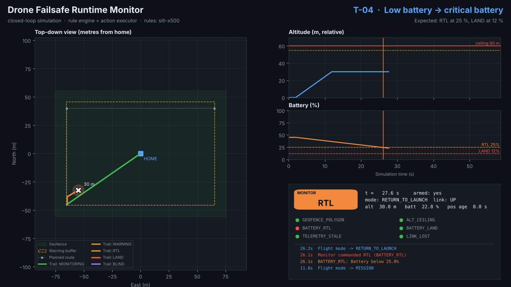
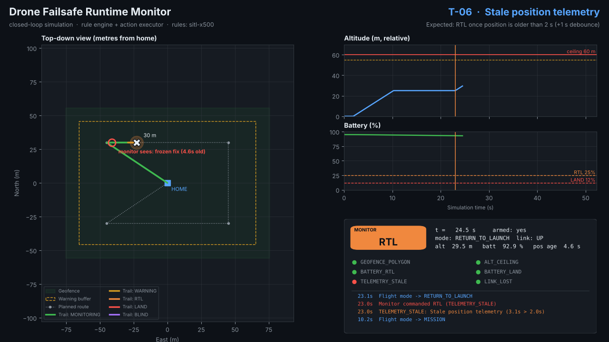
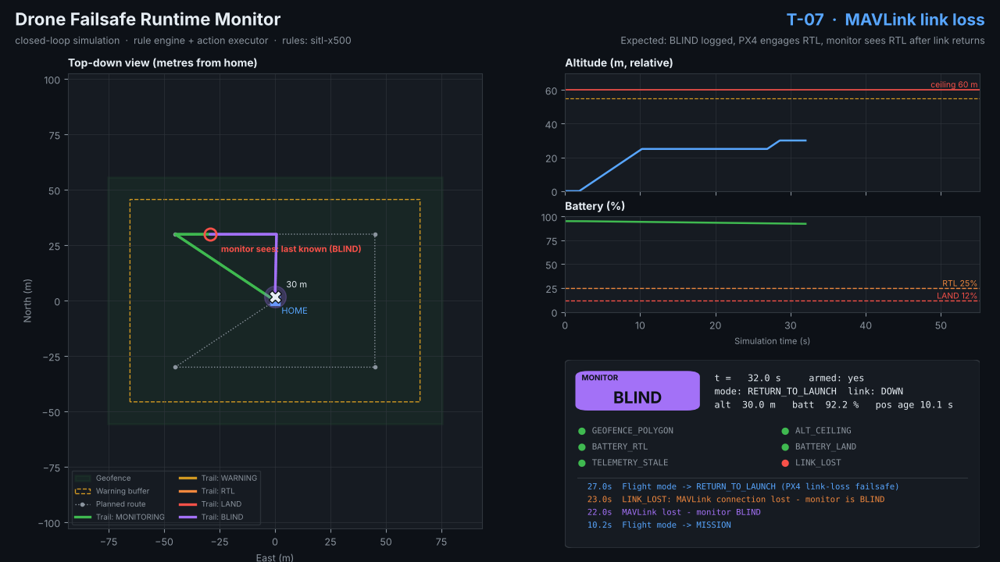
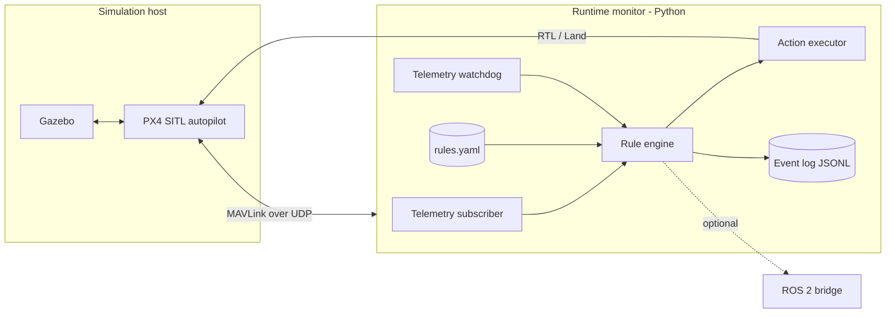

# Drone Failsafe Runtime Monitor


An independent runtime monitor, planned in Python with [MAVSDK-Python](https://github.com/mavlink/MAVSDK-Python), that watches telemetry from a [PX4](https://px4.io/) drone flying in **SITL** (software-in-the-loop) with **Gazebo**. It checks the telemetry against declarative safety rules covering geofence, battery and telemetry/link health. When a rule is violated, it commands **Return-to-Launch** or **Land**. Everything runs in simulation, so no hardware is needed. ROS 2 integration is optional.

> **Status: early implementation.** The rule engine, action executor, event log, after-flight report and a closed-loop simulator are implemented and tested. Validation against PX4 SITL + Gazebo is in progress.
>
> ⚠️ This is an educational and research project for simulation. It is **not** certified flight software and must not be relied on for real aircraft.

## See it in action


The monitor flown in closed loop against nine scripted failure scenarios. The full walkthrough is [docs/media/demo.mp4](docs/media/demo.mp4), and [docs/SIMULATION.md](docs/SIMULATION.md) explains how it works.

| Geofence breach → RTL | Battery 25 % → RTL, 12 % → LAND |
|---|---|
|  |  |
| **Frozen position telemetry → RTL** | **Link loss → BLIND, PX4 failsafe takes over** |
|  |  |


```bash
pip install -e ".[viz]"
failsafe-sim all --out sim_output --video --screenshots
```

## Motivation

Autopilots like PX4 already have built-in failsafes. Safety-critical engineering, however, often adds an **independent monitor** (a runtime-verification layer) that checks the main system against a separate, simple, reviewable specification, following the "simplex" and runtime-assurance pattern. This project is a hands-on, hardware-free introduction to that idea: write the rules as data, monitor them, act on violations, and prove the behaviour with repeatable simulated scenarios.

## Key Features

- **Declarative rule file (YAML)** for geofence polygons and altitude ceilings, battery thresholds and telemetry-staleness limits. See [docs/SAFETY_RULES.md](docs/SAFETY_RULES.md).
- **Telemetry subscriber** using the MAVSDK telemetry streams (position, battery, flight mode, armed state, health).
- **Rule engine** with debouncing, hysteresis and severity levels (warn → RTL → land).
- **Action executor** that calls MAVSDK `action.return_to_launch()` / `action.land()`, with retry and confirmation through the flight-mode telemetry.
- **Link and telemetry watchdog** that detects stale telemetry. PX4's own data-link-loss failsafe remains the backstop.
- **Scenario test suite**: scripted SITL missions that deliberately breach each rule.
- **Structured event log** (JSONL) and an after-flight report.
- **Closed-loop simulator** (`failsafe-sim`) that runs the real engine and executor against a kinematic drone model with fault injection, and renders a dashboard, MP4 video and screenshots. No PX4 is needed. See [docs/SIMULATION.md](docs/SIMULATION.md).
- **After-flight report** (Markdown or HTML) with time-to-detect and time-to-act, generated automatically when a live session ends or with `failsafe-sim report <log.jsonl>`.
- **Optional ROS 2 bridge** (planned) that publishes monitor status as ROS 2 topics.

Details: [docs/FEATURES.md](docs/FEATURES.md).

## Architecture Overview



See [docs/ARCHITECTURE.md](docs/ARCHITECTURE.md).

## Tech Stack (planned)

| Area | Choice |
|---|---|
| Autopilot | PX4 Autopilot, SITL build |
| Simulator | Gazebo (new Gazebo, e.g. `make px4_sitl gz_x500`) |
| Monitor | Python 3.10+, `asyncio`, MAVSDK-Python |
| Rules | YAML plus a Pydantic schema, `shapely` for polygon checks |
| Tests | pytest, pytest-asyncio, scripted SITL scenarios |
| Optional | ROS 2 (`rclpy`), Docker for a reproducible SITL environment |

## Project Status

🛠️ **Early implementation.** M0 to M3 are implemented and unit-tested, and the scenario suite (M4) runs in the built-in closed-loop simulator. The remaining work is the PX4 SITL scenario runs and the ROS 2 bridge.

## Roadmap

| Milestone | Scope | Target |
|---|---|---|
| M0: Design | Docs, rule schema, safety-requirements table | Day 1–2 |
| M1: SITL setup | PX4 SITL + Gazebo running, MAVSDK connection, telemetry logging | Week 1 |
| M2: Rule engine | Geofence, altitude and battery rules, debounce and hysteresis, unit tests with recorded telemetry | Week 1–2 |
| M3: Actions and watchdog | RTL and Land with confirmation, telemetry-staleness rule, event log | Week 2 |
| M4: Scenarios | Automated scenario suite (see SAFETY_RULES.md §4), report, optional ROS 2 bridge | Week 3 |

Level: beginner to intermediate. Estimated effort: 2 to 3 weeks.

## Getting Started (planned)

Prerequisites:
- Ubuntu 22.04 or 24.04 (recommended by the PX4 docs for Gazebo simulation), or the PX4 dev Docker images
- PX4-Autopilot source with its toolchain set up (`Tools/setup/ubuntu.sh`)
- Python 3.10+, then `pip install mavsdk`
- Optional: QGroundControl for visual monitoring, and ROS 2

```bash
# Terminal 1: PX4 SITL with Gazebo (from the PX4-Autopilot repo)
make px4_sitl gz_x500

# Terminal 2: monitor
python -m failsafe_monitor --connect udpin://0.0.0.0:14540 --rules rules/example.yaml
```

> The MAVSDK connection URL format depends on the MAVSDK version (older releases use `udp://:14540`). Check the MAVSDK docs for the installed version.

## Configuration Overview (planned)

| Key | Example | Description |
|---|---|---|
| `connection` | `udpin://0.0.0.0:14540` | MAVSDK system address |
| `rules_file` | `rules/example.yaml` | Rule definitions |
| `tick_hz` | `10` | Rule-evaluation rate |
| `dry_run` | `false` | Log violations without commanding the vehicle |
| `log_dir` | `logs/` | JSONL event logs |
| `ros2.enabled` | `false` | Enable the ROS 2 bridge |

## Contributing

The project is in the design phase, so the most useful contributions right now are feedback on the docs. Open an issue to discuss a requirement, design decision or feature before you send a pull request. Planned conventions: feature branches, Conventional Commits, `ruff` + `pytest` in CI.

## License

Released under the [MIT License](LICENSE). Copyright (c) 2026 Mahmudul Islam.

## Author

**Mahmudul Islam** · M.Sc. Computer Science · [github.com/mahmudul-islam32](https://github.com/mahmudul-islam32)
