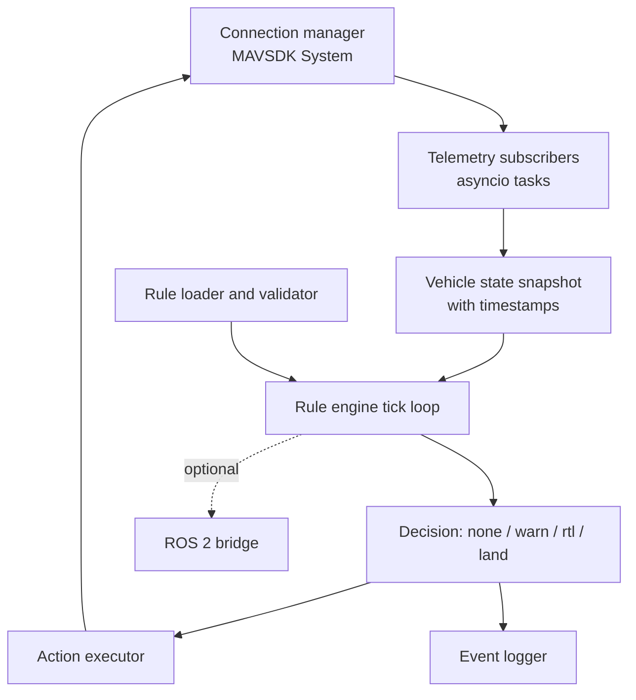
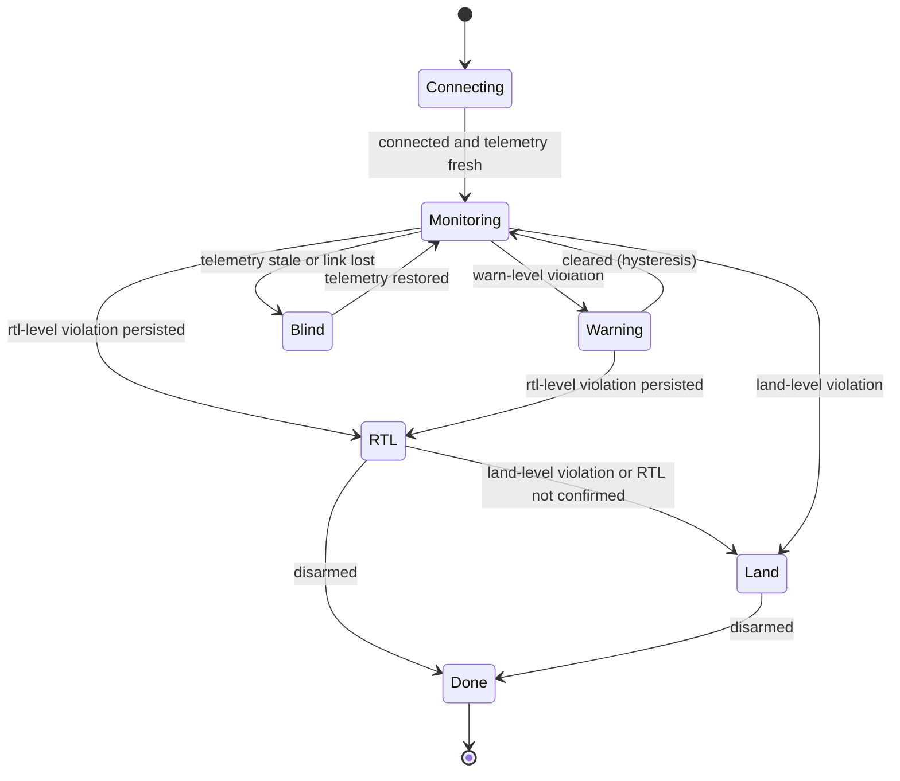
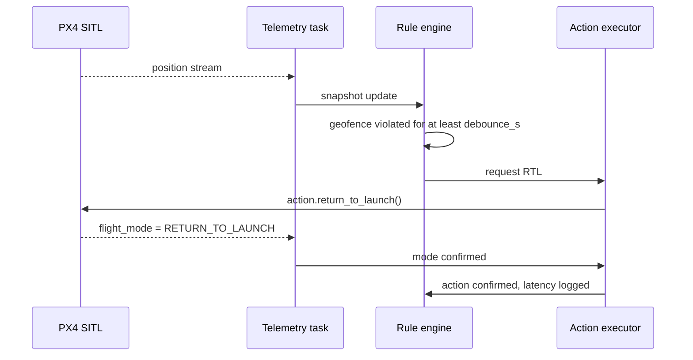

# Architecture: drone-failsafe-runtime-monitor

> Design document. Status: **draft, planned**.

## 1. Principles
- **Independence:** the monitor runs as a separate process with its own specification, and does not change PX4 code or parameters.
- **Simplicity:** small, reviewable rule logic, which supports an argument that the monitor is correct.
- **Defence in depth:** PX4's own failsafes (geofence, low battery, data-link loss) stay enabled. The monitor is an additional layer.
- **Fail-safe defaults:** escalate, never de-escalate automatically, during a flight.

## 2. Components

## 3. Monitor state machine

In `Blind` the monitor cannot command the vehicle. It logs the condition, and PX4's data-link-loss failsafe is expected to act (see SR-07).

## 4. Intervention sequence

## 5. Timing budget (planned targets in SITL)
| Stage | Target |
|---|---|
| Telemetry age at evaluation | ≤ 200 ms |
| Rule tick | 10 Hz |
| Detection after violation onset | debounce_s + ≤ 100 ms |
| Command to mode confirmation | ≤ 2 s, otherwise retry and escalate |

## 6. Test architecture
- **Unit:** pure rule functions with synthetic snapshots.
- **Replay:** recorded JSONL telemetry fed into the engine (no simulator).
- **SITL integration:** headless PX4 + Gazebo, scripted with MAVSDK (takeoff, offboard or mission legs), with faults induced through flight paths, PX4 simulation parameters (e.g. battery drain) or network blocking.
