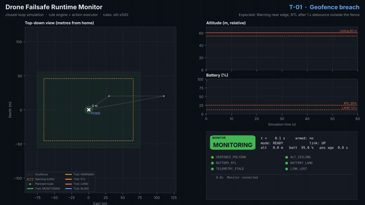
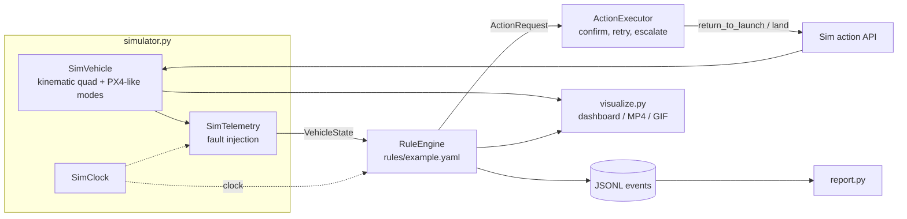
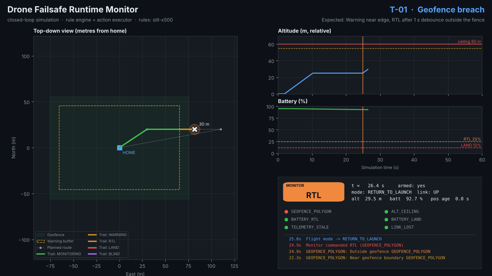
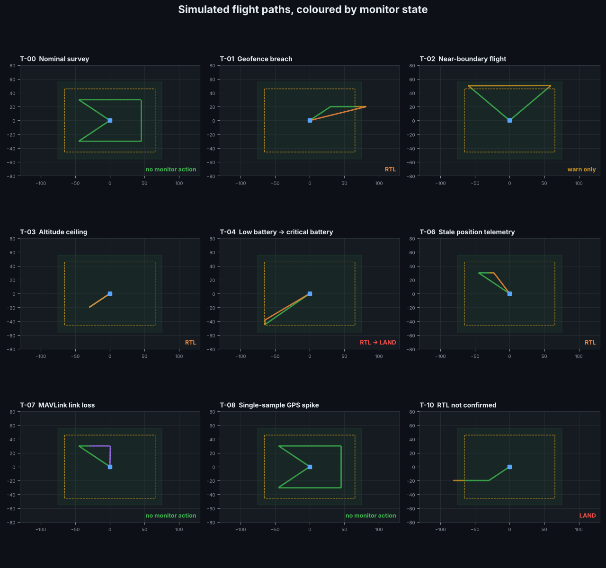

# Closed-loop simulation and visualisation

The `failsafe-sim` tool flies scripted scenarios against the **real** `RuleEngine` and `ActionExecutor`, using a lightweight kinematic drone model in place of PX4 SITL and Gazebo. It runs in seconds on any machine, is fully deterministic, and can render dashboard screenshots, per-scenario videos and an after-flight report for each flight.

> The simulator is a fast feedback loop for the monitor logic. It does not replace PX4 SITL: the vehicle model is simplified (no attitude dynamics, wind or EKF), and PX4's behaviour is approximated.



▶ Full walkthrough video (all scenarios, 4 min): [`docs/media/demo.mp4`](media/demo.mp4). Each scenario on its own: [`docs/media/videos/`](media/videos/)

## Quick start

```bash
pip install -e ".[viz]"          # matplotlib for screenshots/video; ffmpeg must be on PATH for video
failsafe-sim list                # show the built-in scenarios
failsafe-sim run T-01            # fly one scenario, print the timeline, write log + report
failsafe-sim run T-04 --video --screenshots
failsafe-sim all --out sim_output --video --screenshots   # everything + demo.mp4 + overview.png
failsafe-sim report sim_output/logs/events_T-04.jsonl -o T-04.html
```

Output layout:

```
sim_output/
├── logs/events_<ID>.jsonl     # same JSONL event format as the live monitor
├── reports/<ID>.md|.html      # after-flight report (time-to-detect, time-to-act)
├── screenshots/<ID>_*.png     # dashboard at the key moment and at the end
├── videos/<ID>.mp4            # one video per scenario
├── overview.png               # all flight paths, coloured by monitor state
├── summary.png                # results table
└── demo.mp4                   # intro + every scenario + summary
```

## How it works



Every tick (10 Hz, from `tick_hz` in the rules file):

1. **`SimVehicle.step`** advances the drone: takeoff, waypoint mission, then autoland at the end. RTL climbs to at least 30 m, flies home at 8 m/s and descends. Land descends in place. The battery drains with load. If the link is down for 5 s, the vehicle triggers its own RTL, modelling PX4's data-link-loss failsafe (`NAV_DLL_ACT`) as the backstop.
2. **`SimTelemetry`** builds the `VehicleState` the monitor sees and injects faults: GPS spikes, frozen position timestamps and link loss.
3. **`RuleEngine.tick`** evaluates the rules, using an injected `SimClock` so debounce and staleness run in simulated time, faster than real time and reproducibly.
4. **`ActionExecutor.execute`** sends RTL or Land through a stand-in for `mavsdk.System.action`. It then confirms the flight-mode change and retries. If RTL is still not confirmed, it escalates to Land, exactly as it does against a real vehicle.
5. Events go to the same JSONL format as the live monitor, and each tick is recorded for visualisation.

## Dashboard



| Area | What it shows |
|---|---|
| Top-down map | Geofence (green), 10 m warning buffer (dashed amber), planned route, home, and the flown trail **coloured by monitor state**. A red ring marks where the monitor *thinks* the drone is when that differs from the truth (GPS spike, frozen fix, blind). |
| Altitude | Relative altitude with the 60 m ceiling and the 55 m warning line. Vertical lines mark monitor actions. |
| Battery | Remaining charge with the RTL (25 %) and Land (12 %) thresholds. |
| Status panel | Monitor state badge, flight mode, link state, position age, a light for each rule (green OK, amber warning, red violated), and the latest events. |

## Scenarios

| ID | Scenario | Fault | Monitor response |
|---|---|---|---|
| T-00 | Nominal survey | none | Monitoring only |
| T-01 | Geofence breach (+T-09 re-entry) | waypoint 35 m outside the fence | Warning in the buffer, **RTL** 1 s after crossing, stays latched after re-entry |
| T-02 | Near-boundary flight | flies 5 m inside the north edge | **Warnings only** |
| T-03 | Altitude ceiling | climbs towards 80 m | Warning at 55 m, **RTL** above 60 m |
| T-04 (+T-05) | Low → critical battery | drain accelerated from 45 % | **RTL** at 25 %, **LAND** overrides at 12 % |
| T-06 | Stale position | position stream frozen for 6 s | **RTL** after 2 s max age + 1 s debounce |
| T-07 | MAVLink link loss | link down for 15 s | **BLIND**: cannot act. PX4 failsafe performs RTL, and the monitor sees it after reconnecting |
| T-08 | GPS spike | one sample 60 m outside the fence | Filtered by the debounce: **no action** |
| T-10 | RTL not confirmed | autopilot ignores RTL | RTL retried, then **escalated to LAND** |



Each scenario has a closed-loop regression test in `tests/test_simulator.py`.

## Adding a scenario

```python
from failsafe_monitor.simulator import Faults, Scenario, run_scenario
from failsafe_monitor.loader import load_rules

scenario = Scenario(
    id="X-01", name="Spike during RTL", description="...", expected="...",
    waypoints=[(0, 0, 25), (40, 60, 25)],           # (north_m, east_m, alt_m) from home
    faults=Faults(gps_spike_at_s=30.0, battery_drain_pct_per_s=0.2),
)
result = run_scenario(scenario, load_rules("rules/example.yaml"), log_dir="logs")
print([(a.action, a.rule_id, a.time_to_detect_s) for a in result.actions])
```

To add it to the CLI, put it in `failsafe_monitor/scenarios.py`.
